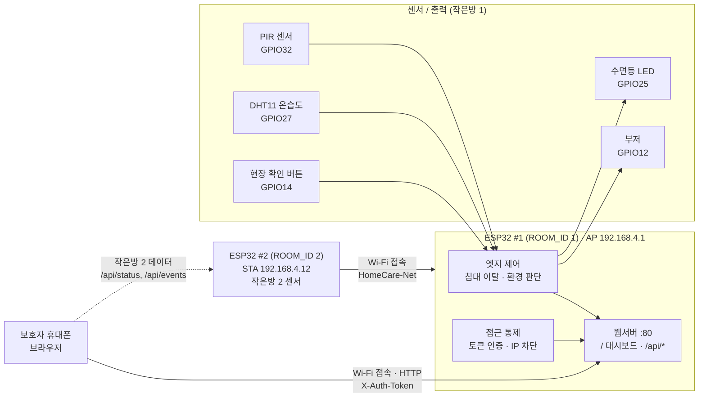

# 홈케어 모니터 (ESP32)

ESP32 보드 하나로 아이 방의 온도·습도·움직임을 감지하고, 보호자가 휴대폰 브라우저로 바로 확인하는 스마트 홈케어 시스템입니다. 인터넷이나 클라우드 없이 동작합니다.

## 아키텍처

- 인터넷 없이 **ESP32 #1이 Wi-Fi 공유기(AP)** 역할을 합니다. 휴대폰과 ESP32 #2가 여기에 접속합니다.
- 휴대폰 브라우저는 #1에서 대시보드 페이지를 받고, 두 보드의 `/api/*`를 3초마다 직접 조회합니다.

## 주요 기능
- **침대 이탈 감지**: PIR 센서에 움직임이 5초 이상 잡히면 수면등을 자동으로 켭니다.
- **수면 환경 감시**: 온도 18~28℃, 습도 30~70%를 벗어나면 알림을 보냅니다.
- **알림**: 부저와 웹 화면 경고음으로 알리고, 보호자가 확인할 때까지 반복합니다. 현장 버튼으로도 확인 처리할 수 있습니다.
- **보안**: 토큰으로 인증하고, 5번 연속 실패하면 해당 IP를 5분 동안 차단합니다.

## 파일
| 파일 | 설명 |
|---|---|
| `esp32/HomeCareNode/HomeCareNode.ino` | ESP32 펌웨어 (Wi-Fi, 웹서버, 센서 제어) |
| `esp32/HomeCareNode/web_page.h` | 보호자용 웹 대시보드 화면 |

## 준비물
- ESP32 DOIT DevKit V1, DHT11, PIR 센서(HC-SR501), LED와 330Ω 저항, 능동 부저, 버튼
- Arduino IDE, ESP32 보드 패키지
- 라이브러리: DHT sensor library, Adafruit Unified Sensor

배선은 `HomeCareNode.ino` 맨 위 주석을 참고하세요.

## 실행 방법
1. Arduino IDE에서 `HomeCareNode.ino`를 열고 보드를 **DOIT ESP32 DEVKIT V1**으로 선택한 뒤 업로드합니다.
2. 휴대폰을 Wi-Fi **`HomeCare-Net`**에 연결합니다. 비밀번호는 코드의 `AP_PASS` 값입니다.
3. 브라우저에서 **http://192.168.4.1/** 에 접속합니다.
4. 코드의 `AUTH_TOKEN` 값을 입력하면 대시보드가 열립니다.

> 보드를 2개 쓰려면 두 번째 보드는 `ROOM_ID = 2`로 바꿔서 업로드합니다. 보드가 1개뿐이면 웹 화면에서 작은방 2가 "연결 끊김"으로 표시됩니다.
